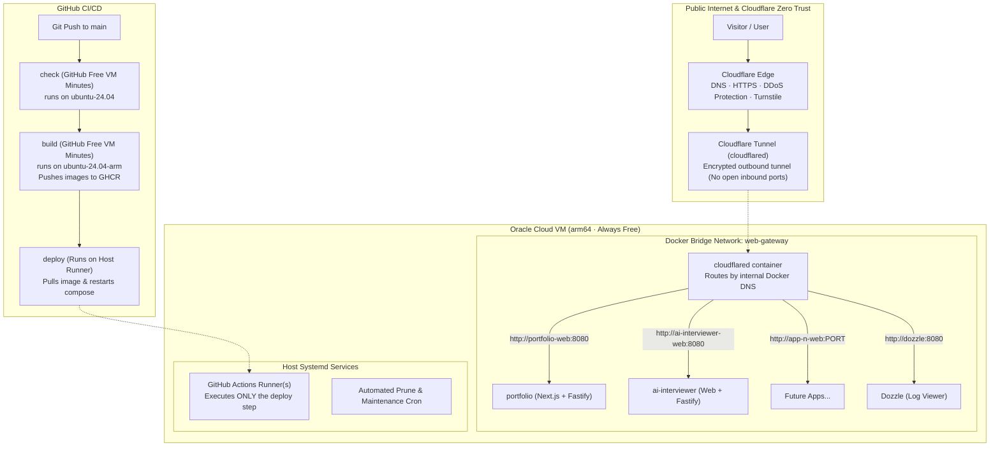

# Server Infrastructure & Multi-App Host Management

Central repository for configuring, operating, and orchestrating self-hosted applications on the Oracle Cloud Infrastructure (OCI) Always Free Ampere (arm64) VM.

## Architecture Overview



---

## Core Principles

1. **Zero Open Inbound Ports**: All external HTTP/HTTPS traffic reaches the VM solely through an outbound Cloudflare Tunnel. The VM firewall drops all inbound public internet requests.
2. **No Port Collision Roulette**: Apps do not bind arbitrary host ports (`8080`, `8081`, `8082`). Instead, every application joins the shared `web-gateway` Docker network, and Cloudflare Tunnel directs traffic using container service names directly (e.g. `http://portfolio-web:8080`).
3. **CI/CD Resource Protection (Build on GitHub Free Minutes, Deploy on Host)**:
   - **Check & Test**: Runs on standard GitHub-hosted runners (`ubuntu-24.04`) using free tier minutes.
   - **Image Build & Packaging**: Runs on GitHub-hosted ARM64 runners (`ubuntu-24.04-arm`) using free tier minutes, caching layers in GitHub Actions cache, and publishing to GitHub Container Registry (GHCR).
   - **Host Machine Deploy**: The self-hosted runner on the VM **only** runs the lightweight deploy job: it writes `.env`, runs `docker compose pull`, runs `docker compose up -d`, and checks `/api/health`. The VM never builds images or compiles code, protecting live production apps from CPU/RAM spikes.
4. **Hard Resource Boundaries**: Every container must enforce explicit `mem_limit` and `cpus` caps to prevent runaway memory leaks or CPU saturation from destabilizing neighbor apps.
5. **Host Self-Healing**: Swap space (4–8 GB with low swappiness) is enabled to absorb spikes, and Docker image pruning runs automatically on a weekly schedule.

---

## Repository Structure

```text
server-infra/
├── README.md               # Architecture, principles, and index
├── REGISTRY.md             # The Single Source of Truth for all deployed services
├── core/
│   ├── docker-compose.yml  # Shared core stack: cloudflared & log viewer
│   ├── .env.example        # Environment template for core services
│   └── cloudflared/
│       ├── config.example.yml # Cloudflare Tunnel ingress rules
│       └── README.md       # Tunnel setup & DNS routing guide
├── bootstrap/
│   ├── setup-host.sh       # One-command host provisioning script
│   ├── cron-prune.sh       # Safe Docker image & cache pruning script
│   └── install-prune-cron.sh # Cron/systemd installation helper
├── templates/
│   ├── docker-compose.app.yml # Standard compose template for new applications
│   ├── github-workflow.app.yml# Standard GitHub Actions template (Build on GitHub, Deploy on Host)
│   └── app-env.example     # Standard env template for apps
└── docs/
    ├── architecture.md     # Deep dive into network topology & resource budgeting
    ├── onboarding-new-app.md # 5-step runbook for deploying a new application
    ├── ci-cd-standard.md   # Comprehensive guide to the GitHub Actions workflow
    └── disaster-recovery.md# Bare-metal recovery instructions
```

---

## Quick Start on the VM

### 1. Provision the Host (One-Time Setup)

SSH into the VM and run the automated bootstrap script:

```bash
git clone https://github.com/mnp-gh/server-infra.git ~/server-infra
cd ~/server-infra/bootstrap
chmod +x *.sh
sudo ./setup-host.sh
./install-prune-cron.sh
```

This will:
- Enable 4GB swap space (with `vm.swappiness=10`).
- Configure Docker log rotation limits (`max-size: 20m`, `max-file: 3`) in `/etc/docker/daemon.json`.
- Create the shared `web-gateway` Docker network.
- Create the standardized application directory layout in `~/srv/`.

### 2. Start Core Services (Cloudflare Tunnel & Logs)

```bash
cd ~/server-infra/core
cp .env.example .env
# Edit .env with your Cloudflare Tunnel token
docker compose up -d
```

### 3. Deploy Applications

Deploying an application is as simple as adding the standardized [templates/docker-compose.app.yml](templates/docker-compose.app.yml) and [templates/github-workflow.app.yml](templates/github-workflow.app.yml) to the application repo. On git push to `main`, GitHub builds the image on GitHub-hosted ARM runners, and the VM runner restarts the container.

---

## Service Registry

See [REGISTRY.md](REGISTRY.md) for the active catalog of all running services, domain bindings, memory limits, and internal network addresses.
